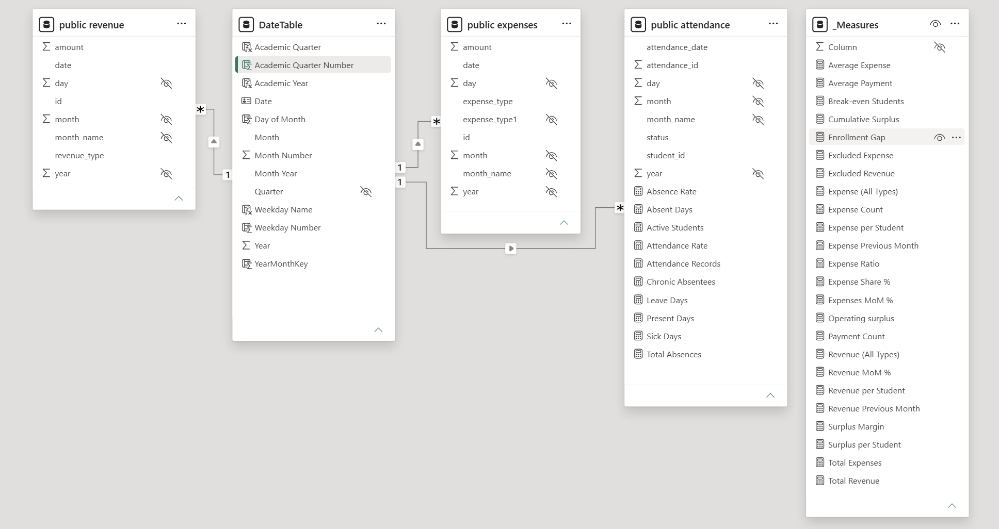
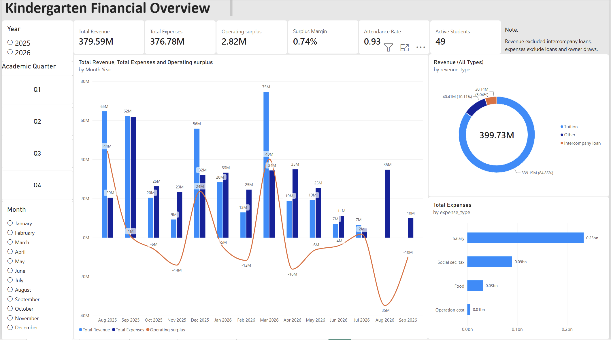
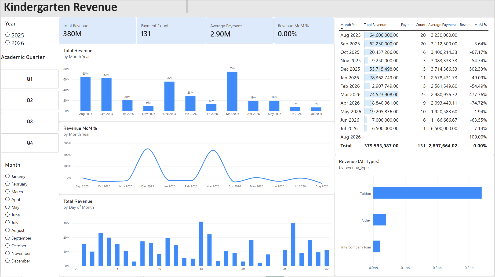
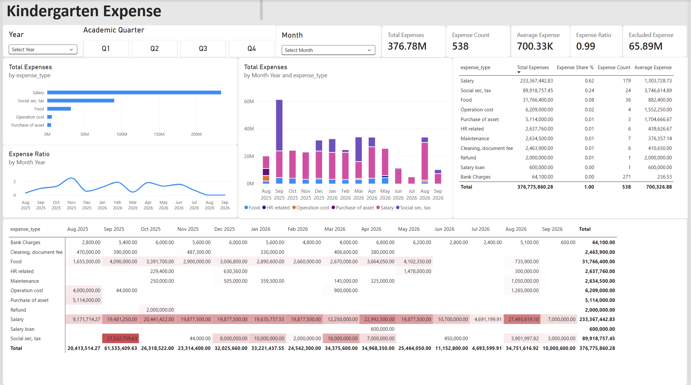
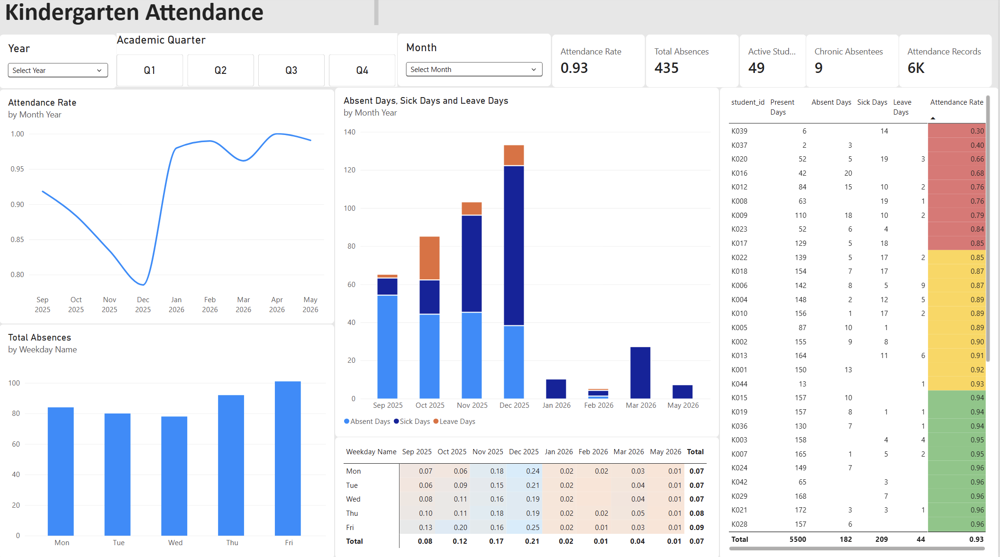
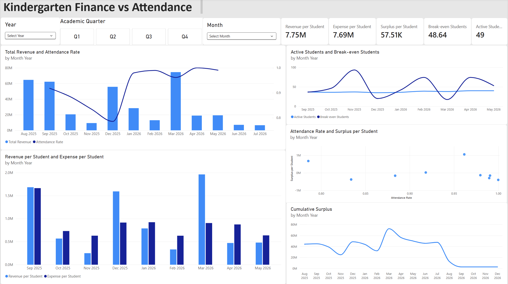

# Financial Analysis of Kindergarten, Aug 2025 to Sep 2026

## Purpose
To give insight of kindergarten's surplus or deficit, 
cashflow source and how many student is needed to break even for principal and owner. 


## Data 
|Table | Content | Key columns |
| :---|:---|:---|
| revenue | Fees received| id, date, revenue_type, amount|
| expenses | Payments made| id, date, expense_type, amount|
| attendance| One row per student per school day  | attendance_id, student_id,attendance_date, status|

Data is from Aug 2025 to Sep 2026 (revenue and expenses) and attendance covers from Sep 2025 to May 2026. 
Data source CSVs loaded into PostgreSQL with the scripts in sql/.
Raw data files are not included in this repository. Data was anonymised before analysis. 

## Repository structure 
```text
Analysis/
├── README.md
├── data /         #sample/anonymised CSV files
├── sql /          #table creation, import, cleaning and analysis scripts
├── powerbi /      #Power Bi report (.pbix)
└── images/      #dashboard screenshots
```

## Data model 
Used star schema desciption where DateTable is related one-to-many to the revenue[date], expenses[date] and attendance[attendance_date] fact tables. All measures live in a _Measures table.



## 5. Business rules and assumptions 
- Academic year runs from August to July. Fees collected in August and September 2026 belong to 2026-2027 and are excluded from 2025-2026.
-  Intercompany loans are excluded from the revenue. Loans and owner payments are excluded from expenses, so the surplus is a true operating result.
- Revenue is cash-basis. Tuition arrives in lumps (mostly in August, September, December, and March which reflects the payment schedule reflected in kindergarten agreement). June and July 2026 tuition revenue is generated from the unpaid tuition fees of 2025-2026. Monthly figures therefore swing with the payment schedule.
- Attendance statuses are present, absent, sick, leave. Attendance rate is calculated by below measurement. 
Attendance rate = Present / all records; Absence rate counts the absent, sick and leave. 
- Academic quarter: Q1 is Sep-Nov, Q2 is Dec-Feb, Q3 is Mar-May and Q4 is Jun-Aug.  
- Remaining one-off items inside expenses: asset purchase (5.1M) and refund (2.0M).

## Key measures

|Measure | Definition |
| :---|:---|
| Total Revenue | Sum of revenue excluding Intercompany loan |
| Total Expenses | Sum of expenses excluding Intercompany loan and owner |
| Operating Surplus | Total Revenue - Total Expenses | 
| Surplus Margin | Operating Surplus/Total Revenue| 
| Expense Ratio | Total Expenses/Total Revenue|
| Excluded Revenue/ Expenses | All types total minus the filtered total |
| Attendance Rate | Present days/attendance records |
| Chronic Absentees | Students below 85% attendance | 
| Revenue/Expense per student | Total divided by active Students |
| Break-even Students | Total Expenses/Revenue per Student |
| Cumulative Surplus | Running total of Operating Surplus |

Reconcilliation checks: Total Revenue + Excluded Revenue = Revenue (All Types); Total Expenses + Excluded expenses Expense(All types)

## Dashboard pages 

| Page | What it shows |
| :---|:---|
| Overview | KPI cards, monthly revenue vs expenses vs surplus, revenue mix, top expense categories |
| Revenue | Monthly revenue, payment count and size, month-over-month change, day-of-month pattern |
| Expense | Category totals and shares, monthly trend, expense ratio, category by month matrix |
| Attendance | Attendance trend, absence reasons, weekday pattern, student-level table |
| Finance vs Attendance | Per-student economics, break-even enrolment, cumulative surplus |







## Analysis and findings
#### Financial result
- Kindergarten's revenue from tuition and other source is about 380 million MNT while total expense excluding intercompany loan and owner draw is 377 million MNT which resuling in about 2.8 million MNT operating surplus. The reason of operating surplus being low is August and September expenses about 44.8 million MNT appears, which is counted to academic year of 2025-2026, while revenue from this months are counted to academic year of 2026-2027.
- Collected revenue is highest in August and September 2025 about 127 million MNT, December 2025 and March 2026 is 131 million MNT, which indicates payment schedule is being followed significantly. Payments cluster around 15th and 25th of the month. 
- Salary is 62% and social security and tax 24% of expenses, combined about 86%. Food supply is around at 8%. 
- Cash peaked at about 72 million MNT in March 2026 and fell to about 47 million MNT by July 2026. August and September costs are for the academic year 2025-2026 and there is not enough evidence that revenue from the new academic year is used within this period. Thus cash reserve is the key to planning. 
- Overall attendance 93% across about 5,900 records and 49 students. Lowest attendance month is December which is the result of weather induced sickness, holiday travel plan, as well as school holiday break. Friday has the most absences. 
- In January 2026 records are recorded as sick without absent days, which suggest that school holiday break and family holiday travel plan effects the total student attending to kindergarten and lowering the number of attendees. 
- Nine students has below 85%; several have very few records which might be the student joining during mid-year, so the true count is lower. 
- No visible month-to-month relationship between attendance and surplus cash timing dominates. 
- With the actual expense and revenue data, break-even is about 43 students on 2025-2026 figures versus 49 enrolled, cushion of about 6 students. However taking consideration of students joining during mid-year, break-even for bugdet for next academic year might be higher. 
- Monthly active students range from 30s to about 40, so using 49 active students understates revenue and cost per student. 

## Recommendations
- Keep a cash reserve to cover August and September costs to precede new tuition. 
- Review the salary and social security and tax as it affects the profitability. 
- Spread tuition instalment schedule to reduce reliance on three lump payments and late balances. 

## Limitations 
- Revenue has no student_id, so payments can not be matched to students. 
- Revenue is cash-basis, break-even assumes costs scale with students, although rent and salaries are largely fixed. 
- Planned: budget vs actual, enrolment forecast, deferred revenue view for next year fees. 

## Authhor
Khishigbayar. B, Date of last update: 11 November 2026. 